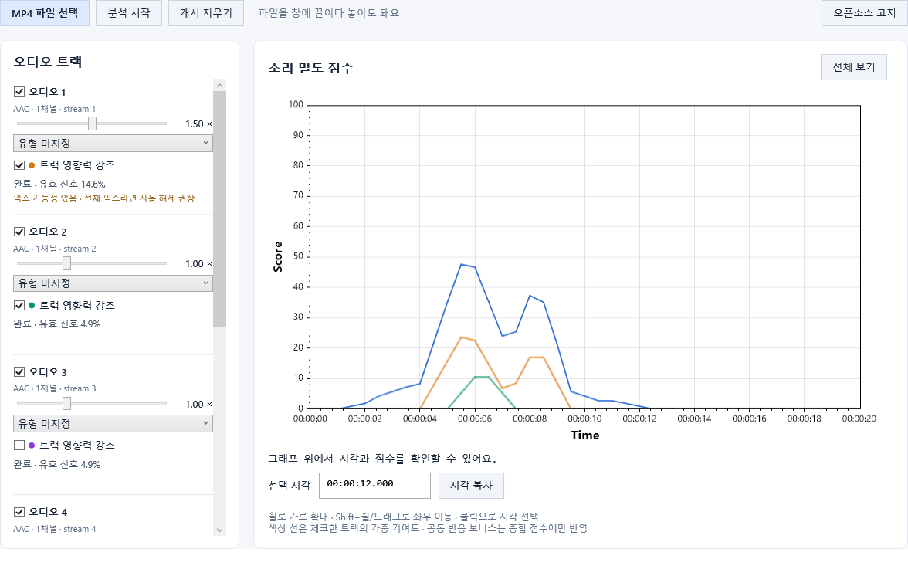

# SoundWeight Graph

SoundWeight Graph는 MP4의 여러 오디오 트랙을 분석해 가장 활발한 **하이라이트 후보를 시간 그래프로 보여주는 Windows 앱**입니다.
마이크·디스코드·게임 소리 중 어떤 트랙을 반영할지 선택하고, 가중치를 조절하며 먼저 살펴볼 구간을 찾을 수 있습니다.

[소스 저장소](https://github.com/eventide-manafield/soundweight-graph) · [Apache-2.0](LICENSE) · [저작자·출처](NOTICE)

> v0.2.0은 [릴리스](https://github.com/eventide-manafield/soundweight-graph/releases/tag/v0.2.0)에서 받을 수 있습니다. 아래 화면과 테스트는 합성 MP4를 사용했습니다.
> 프로그램 표시 이름은 SoundWeight Graph, 실행 파일은 SoundWeightGraph.exe입니다.
> v0.2.0부터 트랙 영향력 강조를 사용할 수 있습니다.



## 어떤 도구인가요?

몇 시간짜리 녹화를 처음부터 끝까지 다시 보기 전에, **소리의 변화가 모인 시간대**를 먼저 살펴보는 도구입니다.
장면의 재미를 AI가 판정하거나 영상을 자동 편집하지는 않습니다. 조용하지만 중요한 장면은 직접 확인해야 합니다.

## 그래프 해상도와 조작

점수는 영상 길이의 퍼센트가 아닌 **고정 0.5초 간격**으로 계산합니다.
3시간 영상은 약 21,600개, 5시간 영상은 약 36,000개의 점을 유지합니다.
전체 보기에선 화면 픽셀에 맞춰 렌더링만 줄이고, 확대하면 해당 시간대의 원본 점수를 자세히 볼 수 있습니다.
표시 곡선에는 기본 약 1.5초 평활화가 적용되며 원시 점수 배열도 별도로 유지합니다.

| 조작 | 동작 |
|---|---|
| 휠 위 / 아래 | 마우스 위치를 중심으로 시간축 확대 / 축소 |
| Shift + 휠 위 / 아래 | 현재 배율을 유지하며 이전 / 이후 시간대로 이동 |
| 왼쪽 드래그 | 시간축 좌우 이동 |
| 전체 보기 | 영상 전체 시간 범위로 복귀 |
| 그래프 클릭 → 시각 복사 | 선택한 시각을 `HH:MM:SS.mmm`로 복사 |

세로 점수축은 **0~100으로 고정**됩니다. 점수가 높을수록 소리 변화나 여러 트랙의 반응이 밀집한 구간입니다.

## 트랙 영향력 강조

트랙별 **트랙 영향력 강조**를 체크하면 그 트랙의 기여도를 종합 그래프 위에 **투명도 40%의 색상 선**으로 표시합니다.
여러 트랙을 함께 선택할 수 있고, 체크박스 옆 색상이 그래프 선 색상과 같습니다.
기여도는 `트랙 활동도 × 해당 가중치 / 분석에 성공해 사용 중인 트랙의 가중치 합계 × 100`을 종합 그래프와 같은 방식으로 평활화한 값입니다.
공동 반응 보너스는 종합 점수에만 반영하므로 강조 선의 합이 종합 점수와 항상 같지는 않습니다.
사용 해제·가중치 0·분석 실패 트랙은 표시하지 않습니다. 강조 체크는 점수나 분석 설정을 바꾸지 않으며 파일을 다시 열면 해제됩니다.

## 사용 방법

1. 릴리스 또는 로컬 빌드의 `SoundWeightGraph.exe`를 실행합니다.
2. MP4를 선택하거나 창으로 드래그합니다.
3. 트랙을 확인하고 **분석 시작**을 누릅니다.
4. 트랙 체크박스와 가중치를 조절하며 그래프를 탐색합니다.
5. 확인할 구간을 클릭하고 **시각 복사**로 편집 프로그램에서 찾아봅니다.

OBS의 첫 트랙이 전체 믹스라면 개별 트랙과 중복 집계될 수 있으므로 체크를 해제하는 편이 좋습니다.
앱은 첫 트랙을 무조건 믹스로 판단하지 않습니다.

배포본은 **EXE 한 개로 실행**합니다. 필요한 미디어 도구와 네이티브 구성요소는 앱이 자동으로 추출할 수 있으며,
이는 사용자가 ZIP을 풀거나 런타임을 따로 설치하는 절차와 다릅니다.

<details>
<summary>개발 환경과 빌드 방법 펼쳐보기</summary>

Windows x64, .NET 10 SDK, PowerShell 7이 필요합니다. 최초 의존성 준비에는 인터넷이 필요합니다.
현재 확인한 실행 환경은 Windows 11 x64이며, 깨끗한 Windows 환경 검증은 남아 있습니다.

```powershell
git clone https://github.com/eventide-manafield/soundweight-graph.git
cd soundweight-graph
./scripts/prepare-tools.ps1
./scripts/build.ps1 -Test -Publish
```

빌드 결과는 `artifacts/publish/SoundWeightGraph.exe`에 생성됩니다.
도구 아카이브는 SHA-256을 검증합니다. 대응 소스와 빌드 레시피는 v0.2.0 릴리스에 별도 첨부되어 있습니다.

| 프로젝트 | 역할 |
|---|---|
| `SoundWeightGraph.Core` | 오디오 프레임 특징, 상대 활동도, 가중 점수 |
| `SoundWeightGraph.Infrastructure` | FFmpeg 프로세스, 도구 추출, 캐시·설정 |
| `SoundWeightGraph.App` | WPF 화면, 트랙 설정, 그래프 탐색 |
| `SoundWeightGraph.Tests` | 점수 및 실제 MP4 처리 검증 |

</details>

## 현재 검증 범위

점수·캐시·미디어 처리 테스트 24개가 통과했고, 실제 WPF 앱과 단일 EXE로 합성 MP4 분석을 확인했습니다.
5시간 분량 합성 데이터로 탐색과 분석 취소를 검사합니다. 실제 5시간 방송의 전체 분석 성능을 측정한 결과는 아닙니다.
실제 OBS 녹화의 후보 품질, 복잡한 PTS, 서로 다른 PC·DPI 환경은 추가 확인이 필요합니다.
검사별 근거와 한계는 [검증 기록](docs/VALIDATION.md)에 기록합니다.

## 라이선스와 크레딧

Copyright 2026 **eventide-manafield**.

직접 작성한 프로젝트 코드는 [Apache License 2.0](LICENSE)으로 제공합니다.
원저작자와 원본 저장소는 [NOTICE](NOTICE)에 기록되어 있습니다.
재배포 시 Apache-2.0의 적용되는 라이선스·고지 보존 및 변경 표시 조건을 따라 주세요.
원본 저장소: <https://github.com/eventide-manafield/soundweight-graph>

FFmpeg 및 다른 외부 구성요소에는 **각각의 원래 라이선스**가 적용됩니다.
[외부 소프트웨어 고지](docs/THIRD_PARTY_NOTICES.md)와 [배포 라이선스 점검](docs/LICENSING.md)을 함께 확인해 주세요.
Apache-2.0 적용은 FFmpeg 대응 소스 제공 등 외부 구성요소의 배포 조건을 대신하지 않습니다.
